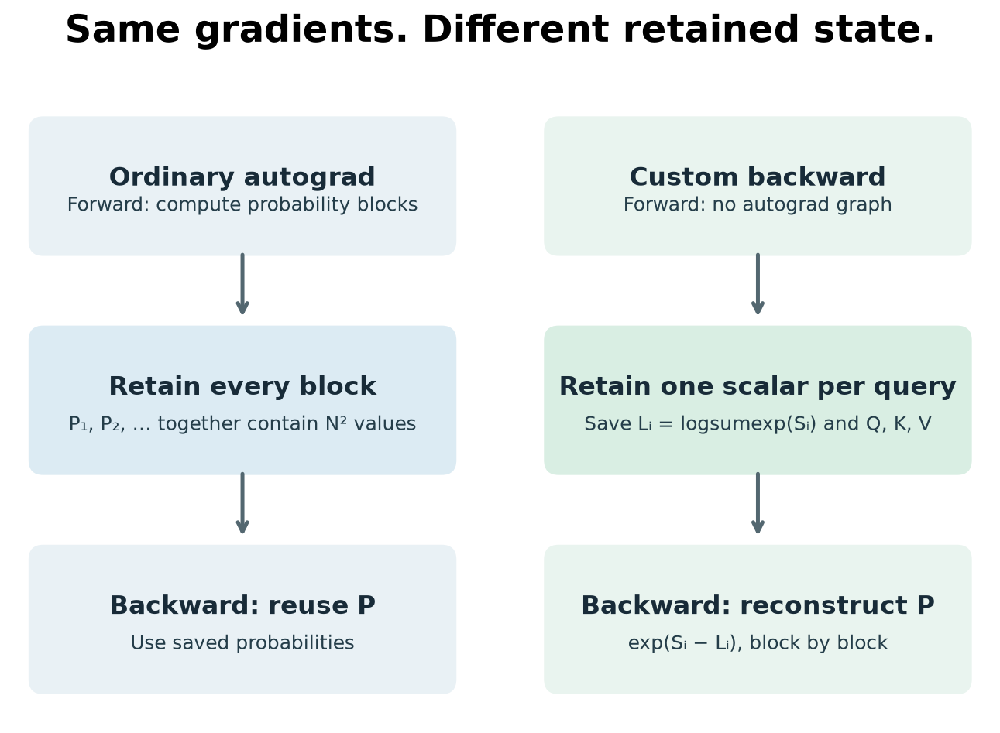

# What attention needs to remember

An executable study of attention's backward pass: derive the gradients, reconstruct the attention probabilities, and measure what autograd retains.

**Start with [the notebook](attention-memory.ipynb).** It contains the mathematical walkthrough, executable checks and recorded figures. This is an educational investigation of established techniques, not a new attention algorithm or a GPU-performance claim. Prepared with coding assistance.



## The question

Splitting queries into smaller blocks reduces each score allocation. Does it also reduce the activations retained for training?

The study compares:

1. A direct attention implementation.
2. Query chunks with ordinary autograd.
3. A custom first-order backward that retains Q, K, V and one log-normalizer per query, then reconstructs probabilities block by block.
4. PyTorch's explicitly selected math backend as a correctness reference and timing baseline.

At N=1,024, batch 1, eight heads and float32, the first two methods retain 32 MiB of additional storage for unmasked backward. The recomputing implementation retains 32 KiB. Q/K/V occupy another 6 MiB and remain required. This is **saved intermediate storage**, not peak memory, and it does not imply a 1,024-fold reduction in total memory.

## Reproduce

Use Python 3.12. In a fresh virtual environment:

```sh
python3 -m venv .venv
source .venv/bin/activate
python -m pip install -r requirements.txt
python check.py
python benchmark.py --lengths 128 512 1024 --repeats 20 --warmup 3
python plot.py
python run_notebook.py
```

`run_notebook.py` starts a local kernel using the invoking Python environment, executes every cell, and saves actual outputs into the notebook. Open the notebook in Jupyter, VS Code or GitHub to read it. An editor can also run it interactively with this environment selected.

The recorded experiment used Python 3.12.10, PyTorch 2.13.0, matplotlib 3.11.1 and macOS arm64. The requirements pin direct dependencies; they are not a full transitive lockfile. No CUDA or MPS measurements are included.

## What the tests establish

- 96 output/gradient comparisons against PyTorch's math backend.
- Float64 and float32, causal and unmasked, contiguous and strided tensors, different value dimensions, and sequence lengths crossing the chunk boundary.
- Finite-difference gradient checks for all three handwritten implementations.
- Future-token perturbations cannot change earlier causal outputs.
- Softmax's analytic backward agrees with autograd, and each score-gradient row sums to zero.
- Six additional float64 stress cases cover uneven/single-row chunks and large finite logits.

Tolerances are fixed in `check.py` and recorded per case. No claim is made for float16, bfloat16, arbitrary padding masks, dropout, GQA or double backward. The custom implementation explicitly rejects unsupported dtypes and uses `once_differentiable` to block higher-order backward.

## Measurement definitions

**Saved intermediate storage:** saved-tensor hooks deduplicate underlying storages retained during forward and exclude pre-existing Q/K/V and upstream-gradient storage. The count excludes transient workspace, allocator overhead, outputs not saved by autograd, and gradient buffers. It is not operating-system RSS or accelerator peak allocation.

**Timing:** single-threaded CPU, float32, three warmups, 20 repetitions, seeded interleaving of methods. Inference runs without gradients; training includes forward and Q/K/V gradients with a fixed random upstream gradient. No compilation. Other processes can affect latency, so results are exploratory rather than a hardware ranking.

`results/benchmark.json` preserves every sample and the source hashes present during measurement. `results/correctness.json` preserves all comparison errors and tolerances. Graphs are generated from these files, not illustrative numbers.

## Files

- `attention-memory.ipynb`: guided mathematical and executable walkthrough.
- `attention.py`: implementations and analytic custom backward.
- `check.py`: correctness checks and mathematical invariants.
- `benchmark.py`: timings and saved-storage measurement.
- `plot.py`: figures from recorded measurements.
- `run_notebook.py`: notebook execution and validation.
- `results/`: measurements and figures.

## Attribution and limits

See the [FlashAttention paper](https://arxiv.org/abs/2205.14135) for IO-aware tiling and fused GPU implementation, and [PyTorch's attention API](https://docs.pytorch.org/docs/2.13/generated/torch.nn.functional.scaled_dot_product_attention.html) for library semantics. This code isolates a recomputation idea using query-axis chunks in Python. It does not reproduce the full FlashAttention algorithm or its performance.
